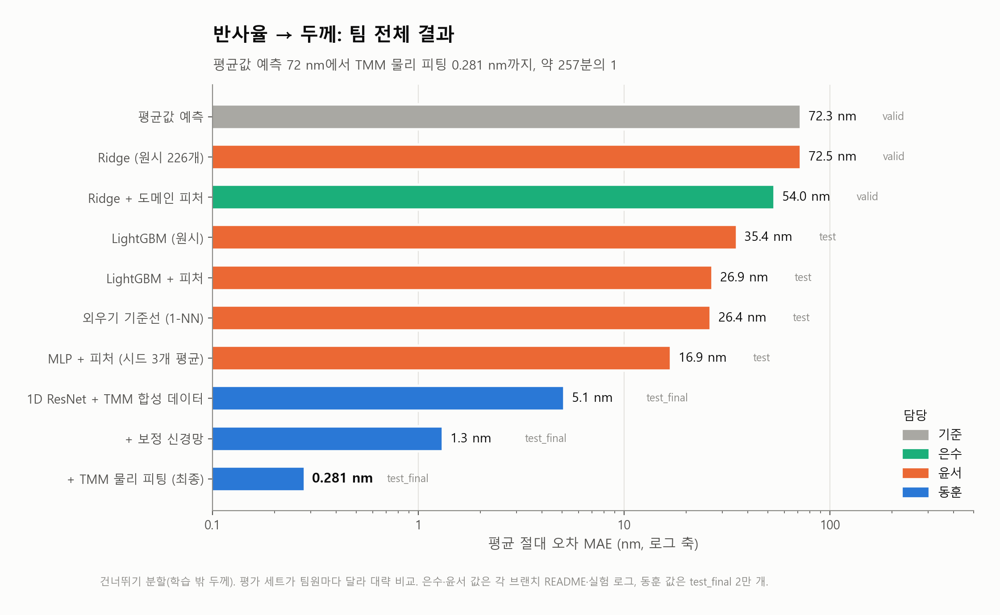

# 4층 박막 두께 예측: 신경망 초기 추정 + TMM 물리 모델 피팅

반사율 스펙트럼 226점을 보고 4층 박막의 두께 4개를 맞힌다. 신경망이 두께를 먼저 추정하고, 박막 광학 공식(TMM, 전달 행렬법)으로 계산한 곡선을 실제 곡선에 맞춰 두께를 다듬는다.

- 데이터: DACON 박막 두께 데이터 `train.csv`만 사용한다. 정답이 없는 `test.csv`는 쓰지 않는다.
- 결과는 `train.csv`를 나눈 고정 평가 세트 기준이다. 방법은 **모의고사(mock)** 세트로 골랐고, 최종 평가 세트(`test_final`)는 마지막에 **한 번만** 열었다.
- 데이터가 시뮬레이션일 가능성이 높아서, 실제 웨이퍼에서의 성능을 뜻하지는 않는다.
- 자세한 작업 기록과 숫자의 근거는 [HANDOFF.md](HANDOFF.md)에 있다.

## 1. 결과 요약

**최종 평가 test_final 2만 개** (학습 때 보지 않은 두께 조합, 한 번만 평가), CPU 기준.

| 구성 | 신경망만 MAE | 최종 MAE | 중앙값 | 20 nm 넘게 틀림 | 곡선은 맞는 오답 | 샘플당 | (참고) mock 최종 |
|---|---|---|---|---|---|---|---|
| **A + B 후보를 정련 출발점으로 (최종)** | 5.12 nm | **0.281 nm** | 0.176 nm | **0개** | **26개** | 316 ms | 0.285 nm |
| A만 (기준선) | 5.12 nm | 0.306 nm | 0.176 nm | 18개 | 52개 | 141 ms | 0.295 nm |
| 보정 신경망 | **1.32 nm** | 0.298 nm | 0.176 nm | 16개 | 45개 | 142 ms | 0.295 nm |

- A = 1D ResNet (`s3_resnet`), B = 두께 후보 4개를 내는 1D ResNet (`s3_resnet_k4h`).
- **최종 정확도는 물리 정련이 정한다.** 신경망 단독 오차가 1.3~5.1 nm로 4배 차이 나도 TMM 정련 후에는 0.28~0.31 nm로 모인다. 중앙값은 세 구성이 같다.
- **모의고사와 최종 시험이 같다.** mock → test_final 차이가 0.01 nm 이내라 모델 선택 과정에서 과적합되지 않았다.
- 학습 격자에 없던 두께가 1~4층 섞여 있어도 최종 MAE는 0.27~0.29 nm로 거의 같다(A+B).
- 차이는 얇은 스택과 크게 틀리는 소수 샘플에서만 난다. 총두께 400 nm 미만: A+B 0.525 nm, A만 0.725 nm. 800 nm 이상은 모든 구성이 0.154 nm다.
- 층별 최종 MAE는 0.204 / 0.363 / 0.268 / 0.289 nm. L2(SiO₂)가 가장 어려운 것은 이론 한계(CRLB)의 비율과 같다.
- 발표용 그래프는 [`figures/`](figures/) (`python make_figures.py`), 팀원 결과와 묶은 분석은 [TEAM_ANALYSIS.md](TEAM_ANALYSIS.md).



## 2. 문제와 물리 모델

**구조:** 공기 / L1 SiN / L2 SiO₂ / L3 SiN / L4 SiO₂ / Si 기판, 수직 입사. 두께는 층마다 10~300 nm(10 nm 간격, 30⁴ = 81만 조합).

**파장 축 복원:** 데이터에는 파장 값이 없다. 곡선을 TMM으로 맞춰 보니 226점은 광자 에너지 등간격이었다.

```
E = 1.550 + 0.0124 · w  [eV]   (w = 0..225, 약 286~799 nm)
```

**TMM:** 층마다 복소 굴절률 N = n − ik, 위상 δ = 2πNd/λ로 전달 행렬을 곱해 반사율 R = |r|²를 계산한다. 파장별 SiN·SiO₂·Si의 n, k는 학습용 두께 1,500개만으로 적합했다(`03_fit_optical.py` → `_work/optical_params.csv`). 처음 보는 두께의 곡선도 RMSE 0.0091로 재현한다. 데이터 노이즈 추정치는 σ ≈ 0.0087이므로 노이즈 수준이다.

## 3. 파이프라인

```
반사율 226점
  │
  ├─① 신경망: 1D ResNet이 두께 출발점 제안 (A 1개 + B 후보 4개)
  │     학습 배치의 절반은 TMM으로 만든 연속 두께 합성 곡선 + 노이즈
  │
  ├─② 정련: 출발점마다 LM으로 TMM 곡선을 실제 곡선에 맞춤 (정답 라벨 사용 안 함)
  │
  └─③ 다시 찾기: 곡선이 노이즈 수준까지 안 맞은 샘플만
        무작위 출발점 → 같은 재료 쌍(L1+L3, L2+L4) 배분 바꾸기
        → 총 광학 두께를 유지한 SiN·SiO₂ 맞바꿈
```

TMM은 두 곳에서 쓴다. 하나는 학습 데이터 증강이고, 다른 하나는 신경망 답을 다듬는 물리 모델 피팅이다. 학습 손실에 물리 식을 넣는 PINN과는 다른 방식이다. 학습 손실에 곡선 점수를 넣는 방식(FNO+TMM)도 시도했지만, 신경망만 MAE가 12.6 nm에서 20.8 nm로 나빠져서 버렸다.

## 4. 데이터 분할 (20 nm 건너뛰기)

무작위로 나누면 이웃 격자점이 학습에 들어가서 실제 난이도를 반영하지 못한다. 그래서 학습은 20 nm 간격 부분격자로만 하고, 나머지 격자점으로 평가한다.

| 묶음 | 기준 | 개수 |
|---|---|---|
| train | 네 층 모두 10, 30, …, 290 nm | 50,625 |
| valid | 20, 40, …, 280 nm인 층이 하나 이상 (300 없음), 그중 10% | 65,666 |
| test | 위 조합의 나머지 90% | 590,990 |
| edge (외삽) | 한 층이라도 300 nm | 102,719 |

고정 평가 세트(`_work/eval_sets.npz`)는 다음과 같다. 분석은 practice에서 하고 방법 비교는 mock에서 한다. test_final은 마지막에 한 번만 쓴다.

| 세트 | 개수 | 용도 |
|---|---|---|
| select | 10,000 | 학습 중 best 에폭 고르기 |
| practice | 3,954 | 실패 분석 |
| mock_nn | 51,712 | 신경망만 비교 |
| mock_refine | 10,000 | 정련 포함 비교 |
| test_final | 20,000 | 최종 평가 (한 번 사용, 1장) |

## 5. 실험 경과

| 단계 | 내용 | 주요 결과 |
|---|---|---|
| 1 | FNO vs FNO+TMM(곡선 손실) | 신경망만 12.6 vs 20.8 nm. 물리는 손실보다 데이터 생성·정련에 쓰는 편이 낫다 |
| 2 | 정련 개선 (Gauss-Newton → LM, 다중 시작점) | Valid 1,000개 최종: 예전 정련 13.14 → LM 5.54 → + 다중 시작점 2.95 nm |
| 3 | TMM 합성 데이터 50% + 큰 오차 벌점 | 최종 1.51 nm |
| 4 | 본체 모델 비교 (10에폭, mock_nn) | over20: ResNet 26.0% / CNN+Transformer 36.8% / MLP 42.8% / FNO 61.0% |
| 5 | ResNet 30에폭, 후보 4개 모델 | 신경망만 over20 10.0% / 6.4%, 최종 0.295 / 0.301 nm |
| 6 | 후보 전부를 정련 출발점으로, 보정 신경망 | 최종 0.285 nm, 신경망만 MAE 1.33 nm |

기준선 비교: 신경망 대신 학습 곡선 표에서 가장 비슷한 곡선을 출발점으로 쓰면, 같은 정련을 해도 최종 8.79 nm(실패 982개)다. 신경망 출발점은 0.353 nm(실패 13개)이고 7배 빠르다.

## 6. 파일

| 파일 | 역할 |
|---|---|
| `01_cache_grid.py` | `train.csv` → `_work/grid.npy` (30,30,30,30,226) |
| `02_split.py` | 20 nm 건너뛰기 분할 → `_work/split.npz` |
| `03_fit_optical.py` | 학습용 두께만으로 파장별 n, k 적합 → `_work/optical_params.csv` |
| `make_eval_sets.py` | 고정 평가 세트 생성·확인 → `_work/eval_sets.npz` |
| `common.py` | numpy TMM, 야코비안, LM 정련, 다시 찾기, 판정 기준 |
| `tmm_torch.py` | 미분 가능한 TMM (PyTorch) |
| `models.py` | ResNet1d, CNNTransformer, MLP, FNO1d, 보정 신경망 |
| `04_train.py` | 신경망 학습 → `_work/runs/<name>/` |
| `06_train_corrector.py` | 보정 신경망 학습 |
| `05_eval.py` | 정련 포함 평가 → `_work/eval_<set>_<n>_<tag>.json` |
| `compare_nn.py` | 신경망만 비교 → `_work/diag/<out>.json` |
| `diag_*.py` | 기준선, 노이즈, 곡선은 맞는 오답 분석 |
| `run_*.ps1` | 실제로 돌린 실행 기록 |
| `make_figures.py` | 발표용 그래프 9장 → `figures/` |
| `TEAM_ANALYSIS.md` | 팀원 4명 결과 통합·교차 분석 (`_work/diag/team_crosscheck.py`) |

저장소에 들어 있는 결과물:
- 모델 가중치: `_work/runs/s3_resnet`, `s3_resnet_k4h`, `s4_corr`의 `best.pt`. 다른 모델은 학습 기록(`log.json`)만 있다.
- 평가 결과: `_work/eval_*.json`(mock_refine, valid, test_final), `_work/runs/eval_tf_*.log`, `_work/diag/*.json`.
- 분할·평가 세트 인덱스: `split.npz`, `eval_sets.npz`.

## 7. 재현

환경: Python 3 (numpy, pandas, scipy, PyTorch), CPU만으로 동작한다. 개발 환경은 numpy 2.3.5, torch 2.13.0+cpu였다.

`train.csv`는 이 폴더의 **상위 폴더**에 둔다(`common.PROJECT`). `grid.npy`(0.7 GB)는 저장소에 없으므로 처음에 만든다.

```powershell
$env:PYTHONIOENCODING='utf-8'
python 01_cache_grid.py
# split.npz, optical_params.csv, eval_sets.npz는 저장소에 있다. 다시 만들 때만:
#   python 02_split.py ; python 03_fit_optical.py ; python make_eval_sets.py

# 학습 (CPU 6코어 기준 1.4~2.3시간씩)
python 04_train.py --mode fno --arch resnet --epochs 30 --synth-frac 0.5 --mse-w 0.1 --select over20 --name s3_resnet
python 04_train.py --mode fno --arch resnet --epochs 30 --synth-frac 0.5 --mse-w 0.1 --select over20 --k 4 --synth-hard 0.5 --name s3_resnet_k4h
python 06_train_corrector.py --base s3_resnet --name s4_corr

# 평가 (mock_refine 1만 개, 20분~1시간)
python 05_eval.py --runs s3_resnet --extra-run s3_resnet_k4h --all-cands --tag s4_a_plus_b
python 05_eval.py --runs s4_corr --fast --tag s4_corr
python compare_nn.py s3_resnet s3_resnet_k4h s4_corr --out compare_s4

# 최종 평가 (test_final 2만 개, 모델을 정한 뒤 한 번만. A+B 약 1.8시간)
python 05_eval.py --runs s3_resnet --extra-run s3_resnet_k4h --all-cands --set test_final --tag tf_a_plus_b
python 05_eval.py --runs s3_resnet --fast --set test_final --tag tf_a_base
python 05_eval.py --runs s4_corr --fast --set test_final --tag tf_s4_corr

# 그래프
python make_figures.py
```

`--mode fno`는 "두께 점수만 쓰는 학습"이라는 뜻이고 모델 종류(`--arch`)와는 상관없다. 예전 명령과 호환하려고 이름을 남겨 두었다.
